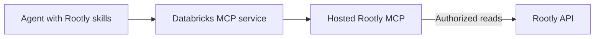

# Rootly skills and MCP on Databricks

Connect an agent to Rootly through a governed Databricks MCP service, then load
the canonical Rootly skills in a supported client. The service provides tools;
the skills provide evidence-grounded incident workflows. Registering one does
not automatically install the other.

The diagram shows the read-oriented workflows documented here. The underlying
MCP server can expose additional capabilities; configure its permissions before
using it with incident skills.

## Choose a guide

- [MCP setup](mcp.md): register the hosted server and connect an agent.
- [Skill publication](skills.md): reuse canonical folders in Unity Gateway Skills.
- [Security and permissions](security.md): identities, tool selection and data access.
- [Examples](examples.md): read-only prompts and fictional evidence walkthroughs.
- [Troubleshooting](troubleshooting.md): identify which connection needs attention.
- [Publishing](publishing.md): provider onboarding and MCP listing preparation.

## Skills are a separate layer

The seven canonical incident workflows remain in this repository's `skills/`
directory. They teach an agent how to reason about evidence and draft useful
answers. An MCP connection supplies tools; it does not automatically distribute
these workflows. Answers still depend on the active connection, effective
permissions and freshness of the retrieved records.

Use the [normal installation guide](../install.md) for your supported coding
agent or the [Unity Catalog skills route](skills.md) for governed distribution.
If the agent calls Rootly through Databricks, configure the intended MCP service
and restrictions explicitly. Verify the active connection and successful skill
loading rather than assuming another connector or installation is in use.

This documentation does not establish Databricks Marketplace availability or
completed host validation. Verify the actual listing, client behavior and
permissions before selecting a production installation method.
